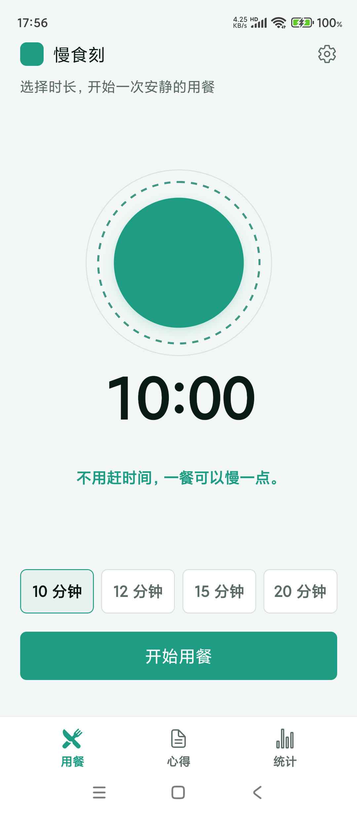
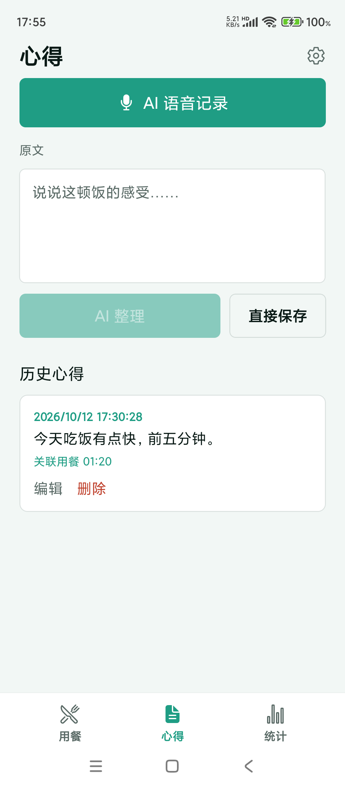
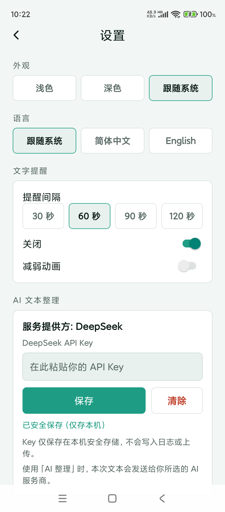

# 慢食刻 BiteTempo

[简体中文](./README.md)

> A quiet timer companion for people who eat too fast: pick a duration, finish the meal slowly, then say what you thought of it — the AI only strips the filler words and keeps a meal journal you can actually look back on.

<p align="center">
  
  
  
</p>

## What is this

You rush through meals, your attention drifts to the phone, and by evening you can't recall what you ate — let alone how it felt. BiteTempo is a small, quiet Android app for those two moments:

- **While eating**: choose 10 / 12 / 15 / 20 minutes. An orb breathes gently, a large countdown runs, and one mindfulness line rotates silently underneath — **no chime, no vibration, ever**.
- **Afterwards**: say a sentence about the meal (or type it). The AI does exactly one thing: remove filler words while keeping facts, negations, numbers and time untouched. You see both versions side by side and confirm before anything is saved.

Two bottom tabs, "Meal" and "Journal", plus a gear icon for settings. Nothing deeper.

## Features

- **Orb timer**: four presets, pause / resume / end early (the actual duration is what gets stored, not the target); background or lock the phone and it resumes from real elapsed time.
- **Silent text rotation**: a new line under the countdown every 60 s (30 / 90 / 120 s or off), paused whenever the timer is.
- **Journal**: dictate or type the raw note → "Polish with AI" → compare raw vs. polished → edit and confirm, or save directly; history supports edit and delete, and an unfinished draft survives tab switches.
- **AI polishing (bring your own key)**: DeepSeek in v1, with a key you enter yourself. No advice, no health claims — filler words out, your meaning intact.
- **Theme & language**: light / dark / follow system (default), Simplified Chinese / English / follow system; switching never loses the running timer or a draft.
- **On-device storage**: sessions, notes and settings live in local SQLite — no account, no cloud sync.

## Data & privacy

- Notes and polished text stay on the phone; there is no server belonging to this project.
- The API key is kept in the system secure store only — never logged, never in code.
- Text is sent to your chosen AI provider only when you tap "Polish with AI", and the screen says so next to the button.
- The microphone is used only when you start a voice note; no background recording.

## Known limitations

- **System speech recognition fails on some devices** (verified on two Xiaomi / MIUI phones: the engine recognises audio but never returns it to apps). The app tells you when this happens; the keyboard's voice input or plain typing still works, and saving plus AI polishing are unaffected. Investigation notes: `docs/qa/evidence/week09/VOICE-FINDING.md`.
- Deliberately out of scope: dietary advice, health diagnosis, trend scoring, spoken prompts, notification sounds, social features and accounts.
- Not published to any app store, and there is no web version.

## Quick Start

Requires Node.js, JDK 17 and the Android SDK (for native builds).

```bash
npm install
npx expo start          # dev server (QR code or emulator)
npx expo run:android    # build/install a Development Build on a device or emulator
```

Download the published build: open [Releases · v1.0.0](https://github.com/wanghoufan/p047-mindful-eating/releases/tag/v1.0.0) and grab `BiteTempo-1.0.0-universal.apk` (universal, Android 7.0+; the page carries the SHA-256 and install notes; the repo is private, so downloading requires signing in to your GitHub account).

The locally built artifact is at:

```
android/app/build/outputs/apk/release/app-release.apk
```

Checks:

```bash
npm run typecheck
npm run lint
```

## Tech stack

Expo SDK 57 / React Native 0.86 / TypeScript, with `expo-router` for the two tabs and settings; `expo-sqlite` for data, `expo-secure-store` for the key, `i18next` for locales. System speech recognition goes through a minimal Kotlin bridge over Android's SpeechRecognizer. The countdown is a monotonic-clock state machine with wall-clock correction rather than a per-second decrement, so a locked phone doesn't skew the timing.

## Docs

- Product plan (requirements, acceptance criteria): `docs/pm/PRODUCT_PLAN_V1.0.md`
- Visual and interaction baseline (HTML prototype): `docs/design/prototype/index.html`
- On-device test evidence and bugs: `docs/qa/evidence/`, `docs/qa/`
- Self code review: `docs/review/`

## Status

v1.0.0, Android first, **finishing development**: the installable build is published on GitHub Releases (`v1.0.0`); not listed in any app store, no web version. A personal learning project.
