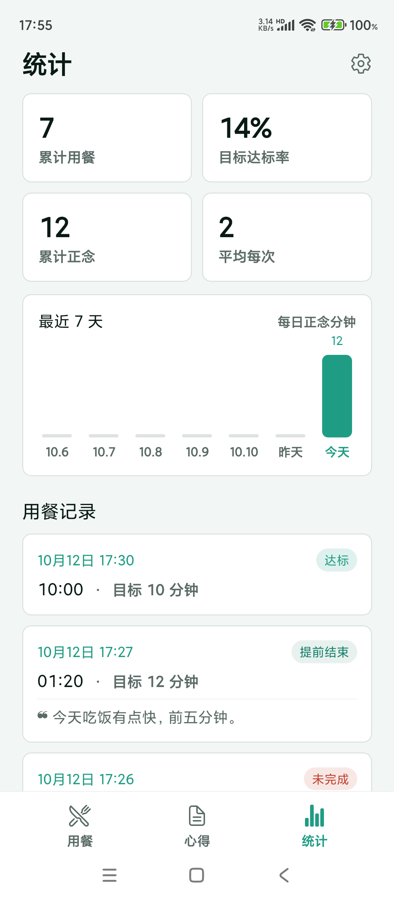

# 慢食刻 BiteTempo

[English](./README.en.md)

> 给吃饭太快的人一个安静的计时搭档：选好时长慢慢吃完一顿饭，饭后把感受说出来，AI 只帮你去掉口水词，留下一份能随时回看的用餐记录。

<p align="center">
  
  
  
</p>

## 这是什么

吃饭总想快点结束、注意力又被手机带走；想记点什么又懒得打字，过几天连吃了什么都想不起来。慢食刻（BiteTempo）把这两件事做成一个安静的安卓小应用：

- **吃饭时**：选 10 / 12 / 15 / 20 分钟，光球缓缓呼吸，大字倒数，倒计时下方一句慢食提示无声轮播——**全程不响铃、不振动**。
- **吃完后**：把这顿饭的感受说一句（或直接打字），AI 只做一件事——去掉「然后就是」这类口水词，事实、否定、数字、时间原样保留，改完给你前后对照，确认了才存。
- **回头看**：每一顿饭都自动留档，统计页把累计餐数、达标率、正念时长和最近 7 天的节奏一眼摊开。

三个底部标签「用餐」「心得」「统计」，加一个顶部齿轮进设置，没有第三层菜单。

## 功能

- **光球计时**：四档时长、暂停 / 继续 / 提前结束（结束时记录实际用时，不是目标时长）；切后台或锁屏回来，按真实时间继续。
- **无声文字轮播**：倒计时下方每 60 秒换一句（可设 30 / 90 / 120 秒或关闭），暂停时跟着暂停。
- **心得记录**：语音或手输原文 →「AI 整理」→ 原文与整理稿对照 → 编辑确认或直接保存；历史可增删改，编辑中途切走草稿不丢。
- **心得挂到那顿饭**：计时结束后点「记录一点心得」，这条心得会挂到刚结束的那次用餐上，历史里标出「关联用餐 01:20」这样的实际用时。
- **用餐历史**：一按「开始用餐」就落库——正常吃完、提前结束，甚至计时中途退出应用，都会留下一条记录（没结束的记为「未完成」，并注明「计时中退出，自动记录」）。
- **统计**：累计用餐、目标达标率、累计正念分钟、平均每次四张卡片，加最近 7 天正念分钟柱状图（按本地时区分组，今天高亮）。
- **AI 整理（BYOK）**：首版接 DeepSeek，Key 由你自己填；不给建议、不做健康判断，只去口水词。
- **主题与语言**：浅色 / 深色 / 跟随系统（默认跟随），简体中文 / English / 跟随系统；切换不丢当前计时与草稿。
- **本机存储**：用餐记录、心得、设置都存在手机本地（SQLite），无账号、无云同步。

## 数据与隐私

- 心得原文与整理稿只存本机，不上传到作者的任何服务器——本项目没有服务器。
- API Key 只保存在系统安全存储（SecureStore），不写日志、不进代码。
- 只有你点「AI 整理」时，文本才会发给你在设置里填的那个 Key 对应的 AI 服务商，界面在按钮旁写明了这一点。
- 麦克风只在你点「AI 语音记录」时使用，不做后台录音。

## 已知限制

- **部分安卓机型的系统语音识别不可用**（实测两台小米 / MIUI：系统识别成功但不把结果回传给应用）。此时应用会提示，你可以改用输入法的语音或手动打字，记录与 AI 整理不受影响。排查记录见 `docs/qa/evidence/week09/VOICE-FINDING.md`。
- 计划中不做：饮食建议、健康诊断、趋势评分、TTS 播报、提示音、社交与账号体系。
- 尚未发布到应用市场，也还没有在线网页版。

## 快速开始

需要 Node.js、JDK 17、Android SDK（构建原生时）。

```bash
npm install
npx expo start          # 开发调试（扫码或模拟器）
npx expo run:android    # 生成/安装 Development Build 到真机或模拟器
```

已发布安装包：打开 [Releases · v1.1.0](https://github.com/wanghoufan/p047-mindful-eating/releases/tag/v1.1.0)，下载 `BiteTempo-v1.1.0.apk`（Android 7.0+ 通用包，页面内有 SHA-256 与安装说明）。这份安装包对应 **v1.1.0**，已包含**用餐历史与统计**（三个底部标签）；国内下载可走蒲公英：<https://www.pgyer.com/manshike>。

本地构建产物在：

```
android/app/build/outputs/apk/release/app-release.apk
```

代码自检：

```bash
npm run typecheck
npm run lint
```

## 技术栈

Expo SDK 57 / React Native 0.86 / TypeScript，`expo-router` 管三个 Tab 与设置；`expo-sqlite` 存数据、`expo-secure-store` 存 Key、`i18next` 管中英文；原生语音识别通过一个最小 Kotlin 桥接（Android SpeechRecognizer）。计时用「单调时钟 + 挂钟校正」的状态机，不靠每秒累减，所以锁屏回来不会跑偏；统计按本地时区在 JS 侧聚合，避开跨时区日界线的错算。

## 文档

- 产品计划（需求、验收标准）：`docs/pm/PRODUCT_PLAN_V1.0.md`
- 视觉与交互基准（HTML 原型）：`docs/design/prototype/index.html`
- 真机测试证据与缺陷记录：`docs/qa/evidence/`、`docs/qa/`
- 代码自审记录：`docs/review/`

## 状态

v1.1.0，**开发收尾阶段**：安装包已在 GitHub Release（`v1.1.0`）与蒲公英（<https://www.pgyer.com/manshike>）提供，含用餐历史与统计；未上架应用市场、无网页版。个人学习项目。
